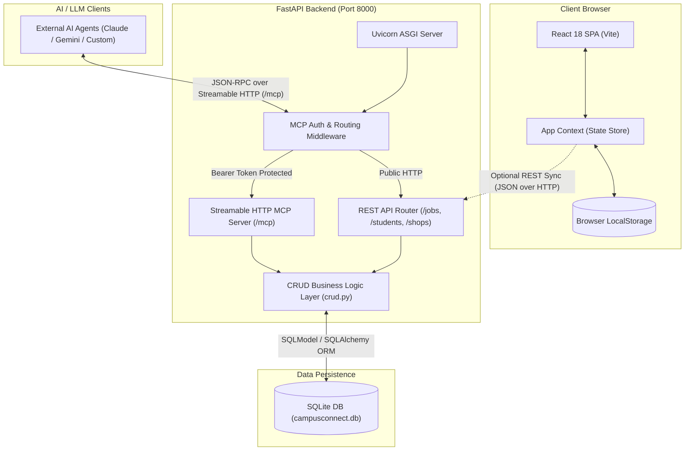
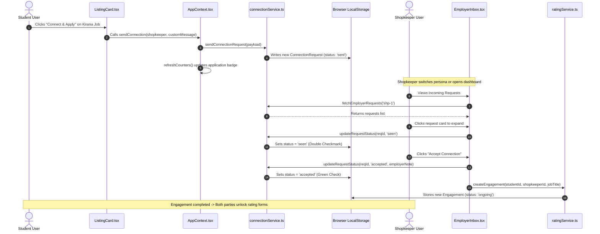
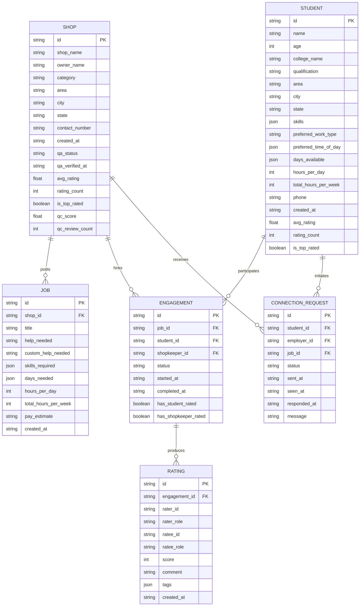

# 🛠️ CampusConnect — Technical Stack & Architecture

This document provides a comprehensive technical overview of the **CampusConnect** codebase, detailing the architectural choices, data flow, component interactions, and deployment requirements.

---

## 1. Project Overview

CampusConnect is a hyperlocal [operating within a small local neighborhood] marketplace connecting college students seeking flexible, part-time work with local neighborhood shopkeepers (such as kirana stores, cafes, pharmacies, and stationery shops) needing reliable short-term assistance. 

Students often struggle to find flexible jobs matching their class timetables within commuting distance, while local business owners lack a fast, trustworthy way to hire nearby youth. CampusConnect solves this through a dual-role dashboard featuring route-based student onboarding, engagement-gated two-sided ratings (students and employers rate each other), food safety QA [Quality Assurance] inspections, and WhatsApp-style application delivery tracking.

---

## 2. Tech Stack Table

| Layer | Technology | Purpose | Why this choice |
| :--- | :--- | :--- | :--- |
| **Frontend Framework** | React 18 (`react`, `react-dom` v18.3.1) | Renders the component hierarchy and handles reactive user interface updates. | Provides a declarative component model, rich ecosystem, and fast virtual DOM updates for dynamic multi-step forms and dashboards. |
| **Frontend Language** | TypeScript 5.6 (`typescript`) | Statically typed JavaScript for client-side state, entities, and services. | Eliminates runtime type errors across complex two-sided entities (students, shopkeepers, applications, ratings). |
| **Frontend Build Tool** | Vite 6 (`vite`, `@vitejs/plugin-react`) | Local development server with Fast HMR [Hot Module Replacement] and production bundling. | Starts instantly and builds faster than legacy bundlers using native ES modules and Rollup. |
| **Frontend Styling** | Tailwind CSS 3 (`tailwindcss`, `postcss`, `autoprefixer`) | Utility-first CSS framework for styling components. | Enables rapid UI design with custom theme tokens (`paper`, `marigold`, `teal`, `ink`) without writing bulky custom stylesheets. |
| **Frontend Class Utilities** | `clsx` & `tailwind-merge` | Conditional CSS class merging. | Prevents conflicting Tailwind utility classes when combining dynamic styles across reusable UI elements. |
| **Frontend Routing** | React Router DOM v6 (`react-router-dom` v6.28.0) | Client-side SPA [Single Page Application] routing. | Enables instant page transitions (`/dashboard`, `/student-signup`, `/shopkeeper-signup`, `/qaqc`) without page reloads. |
| **UI Icons** | Lucide React (`lucide-react` v1.16.0) | SVG icon set for UI indicators, badges, and delivery ticks. | Clean, tree-shakeable [bundles only used icons], lightweight SVG icons matching the artisanal UI aesthetic. |
| **Frontend State & Storage** | React Context (`AppContext.tsx`) & Web Storage API (`localStorage`) | Application-wide state sharing and local mock persistence. | Provides zero-dependency reactive state and offline-first mock persistence for rapid prototyping and demonstrations. |
| **Backend Framework** | FastAPI (`fastapi` >= 0.115.0) | Asynchronous REST API framework built on ASGI [Asynchronous Server Gateway Interface] and Starlette. | High execution performance, built-in asynchronous support, and automatic OpenAPI [Swagger] documentation at `/docs`. |
| **Backend Web Server** | Uvicorn (`uvicorn[standard]` >= 0.30.0) | ASGI web server running the Python application on port 8000. | Lightweight and fast Python server implementation utilizing `uvloop` and `httptools`. |
| **ORM & Schemas** | SQLModel (`sqlmodel` >= 0.0.22) & Pydantic | Bridges SQLAlchemy ORM [Object-Relational Mapping] with Pydantic validation. | Maintains single Python models that serve simultaneously as database tables and API request/response validation schemas. |
| **Database** | SQLite (`campusconnect.db`) via SQLAlchemy | Relational data persistence on disk. | Zero-configuration file-based database for local execution; SQLModel connection string permits zero-code switching to PostgreSQL. |
| **AI / Agent Integration** | Model Context Protocol SDK (`mcp` >= 1.0.0 via FastMCP / `MCPServer`) | Streamable HTTP endpoint mounted at `/mcp` exposing structured tools to AI agents. | Standardized open protocol enabling external LLM [Large Language Model] agents to query jobs and talent without exposing PII [Personally Identifiable Information]. |
| **HTTP Client (Testing)** | HTTPX (`httpx` >= 0.27.0) | Async HTTP client used in backend test suite (`test_backend.py`). | Allows testing FastAPI ASGI applications in-process without network overhead. |
| **Configuration** | Python-dotenv (`python-dotenv` >= 1.0.0) | Loads environment settings from `.env` files into Python runtime. | Keeps configuration values (ports, database paths, secret keys) out of source code. |
| **Authentication** | Custom ASGI Middleware (`MCPAuthAndRoutingMiddleware`) | Secures the `/mcp` route using HTTP Bearer Token headers. | Protects AI agent tools against unauthorized invocation while keeping public REST discovery endpoints open. |
| **Deployment Routing** | Vercel SPA Config (`vercel.json`) | URL rewrite rules for single-page applications. | Directs all subpaths back to `index.html` to prevent 404 errors during client-side navigation. |

---

## 3. System Architecture

The following diagram illustrates how the client, backend server, database, and external AI agents interact:



---

## 4. How Components Connect

The application operates across two interconnected tiers:

### 1. Frontend Client Tier
* **Entry Point**: `frontend/index.html` loads `frontend/src/main.tsx`, which mounts `frontend/src/App.tsx`.
* **Routing**: `App.tsx` defines client-side routes using `react-router-dom`:
  * `/dashboard` — Main job browsing, student talent pool, application tracking, and rating management (`pages/DashboardPage.tsx`).
  * `/student-signup` — 3-step transit-themed student registration form (`pages/StudentSignupPage.tsx`).
  * `/shopkeeper-signup` — Mobile-friendly shopkeeper gig posting form (`pages/ShopkeeperSignupPage.tsx`).
  * `/qaqc` — Food safety inspection and document verification panel (`components/qaqc/QAQCDashboard.tsx`).
* **Global State**: `frontend/src/context/AppContext.tsx` provides shared application state, simulated user personas (`Aarav Sharma` as student, `Tanvi Saxena` as shopkeeper), pending counter badges, and connection dispatchers.
* **Service Layer**:
  * `frontend/src/services/connectionService.ts` — Manages WhatsApp-style delivery tracking (`sent` -> `seen` -> `accepted`/`rejected`).
  * `frontend/src/services/ratingService.ts` — Manages engagement-gated bidirectional ratings and summary calculations.
  * `frontend/src/services/vendorService.ts` — Handles FSSAI licenses, hygiene checklists, and student QC [Quality Control] reviews.

### 2. Backend Server Tier
* **Application Initialization**: `backend/app/main.py` initializes the `FastAPI` app with lifespan management to create SQLite tables (`app/database.py`) and start the MCP session manager (`app/mcp_server.py`).
* **Authentication Middleware**: `MCPAuthAndRoutingMiddleware` in `backend/app/main.py` intercepts requests targeting `/mcp`. It validates the `Authorization: Bearer <token>` header against `MCP_API_KEY`.
* **REST Routing**: `backend/app/routes/` groups endpoints into modular sub-routers:
  * `routes/jobs.py` — Exposes `GET /jobs` (with skills, location, availability filters) and `GET /jobs/{id}`.
  * `routes/students.py` — Exposes `GET /students` and `GET /students/{id}`.
  * `routes/shops.py` — Exposes `GET /shops` and `GET /shops/{id}`.
* **Shared Query Engine**: Both the REST endpoints and the MCP tools call `backend/app/crud.py` to ensure consistent query and filtering logic.
* **Database Session**: `backend/app/database.py` establishes the SQLAlchemy engine with `campusconnect.db` and supplies session generators via `Depends(get_session)` and `get_db_context()`.

---

## 5. Request Flow Walkthrough

Below is an end-to-end trace of a student applying to a job listing, followed by employer acceptance and two-sided review generation:



---

## 6. Data Model

The database models are declared using SQLModel in `backend/app/models.py`.



### Entity Summary
1. **`students`**: Stores student profiles, academic qualifications, hourly limits, skills list, and aggregated ratings.
2. **`shops`**: Stores merchant profiles, store categories, locations, phone numbers, and QA food safety status.
3. **`jobs`**: Relates to `shops` via `shop_id`. Details days needed, required skills, and estimated pay.
4. **`engagements`**: Represents a confirmed employment contract between a student and shopkeeper.
5. **`ratings`**: Two-sided rating record generated only after an engagement is marked completed.
6. **`connection_requests`**: Real-time application tracker tracking delivery lifecycle (`sent`, `seen`, `accepted`, `rejected`, `expired`).

---

## 7. Folder Structure

```
Campus_Connect/
├── backend/                                  # Python FastAPI backend & MCP server
│   ├── .env.example                          # Template for environment configuration
│   ├── requirements.txt                      # Python dependencies (FastAPI, SQLModel, MCP, Uvicorn)
│   ├── seed.py                               # Seeds initial mock database records from frontend datasets
│   ├── test_backend.py                       # Automated test suite for REST routes and MCP endpoints
│   └── app/                                  # Application package
│       ├── __init__.py                       # Package initializer
│       ├── main.py                           # FastAPI application entrypoint and MCP middleware
│       ├── database.py                       # SQLite / PostgreSQL connection and session factory
│       ├── models.py                         # SQLModel database models & Pydantic schemas
│       ├── crud.py                           # Reusable queries for jobs, students, and shops
│       ├── mcp_server.py                     # FastMCP Streamable HTTP server & tools implementation
│       └── routes/                           # Modular API endpoints
│           ├── __init__.py                   # Merged API router
│           ├── jobs.py                       # /jobs endpoint with filters
│           ├── students.py                   # /students endpoints
│           └── shops.py                      # /shops endpoints
├── frontend/                                 # React + TypeScript single-page application
│   ├── index.html                            # HTML entry document
│   ├── package.json                          # Frontend dependencies and npm scripts
│   ├── tsconfig.json                         # TypeScript compiler configuration
│   ├── vite.config.ts                        # Vite configuration with path aliases
│   ├── tailwind.config.js                    # Custom theme colors (paper, marigold, teal, ink)
│   ├── postcss.config.js                     # PostCSS plugins for Tailwind and Autoprefixer
│   ├── vercel.json                           # Vercel SPA rewrite configuration
│   └── src/                                  # Application source code
│       ├── main.tsx                          # React DOM root render
│       ├── App.tsx                           # Root component, router routes, and layout
│       ├── index.css                         # Tailwind directives and custom scrollbar styles
│       ├── context/
│       │   └── AppContext.tsx                # Global state store, active personas, and counters
│       ├── data/
│       │   └── mockData.ts                   # Seed data for students, shopkeepers, QA documents
│       ├── types/
│       │   ├── index.ts                      # Core entity types (Student, Shopkeeper, Filters)
│       │   ├── connection.ts                 # Connection request status tracking types
│       │   ├── rating.ts                     # Two-sided rating & engagement types
│       │   └── qaQc.ts                       # Food safety QA/QC inspection types
│       ├── services/
│       │   ├── connectionService.ts          # Application tracking with localStorage backing
│       │   ├── ratingService.ts              # Rating calculation and engagement lifecycle service
│       │   └── vendorService.ts              # Food vendor QA document verification service
│       └── components/                       # Modular UI components
│           ├── common/                       # Navbar, TagInput, DayPicker, Modal, MultiSelectPills
│           ├── dashboard/                    # FilterBar, EmptyState fallback views
│           ├── student/                      # StudentForm, StudentCard, RouteProgressBar
│           ├── shopkeeper/                   # ShopkeeperForm, ListingCard
│           ├── tracker/                      # RequestStatusBadge, MyRequestsTable, EmployerInbox
│           ├── rating/                       # StarRating, RatingModal, RatingSummary, RatingsList
│           └── qaqc/                         # VendorQABadge, VendorQADetailModal, AdminQAPanel
├── campusconnect.db                          # SQLite relational database file
├── start_backend.bat                         # Quick-start script for Windows to launch Uvicorn
├── vercel.json                               # Root deployment configuration
└── README.md                                 # User documentation and feature overview
```

---

## 8. AI/LLM Integration

CampusConnect integrates with AI and LLM agents via the **Model Context Protocol (MCP)**, located in `backend/app/mcp_server.py`.

### Architectural Role
The backend does not query a third-party LLM directly. Instead, it exposes an **MCP Server** over Streamable HTTP at `/mcp`, acting as a standardized data provider for external LLM agents (such as Claude Desktop, Gemini Code Assist, or autonomous job-matching agents).

### Server Implementation
* Built using `mcp.server.fastmcp.FastMCP` (aliased as `MCPServer`).
* Exposed through ASGI via `mcp_server.streamable_http_app(streamable_http_path="/", stateless_http=True)`.
* Intercepted and secured in `backend/app/main.py` using `MCPAuthAndRoutingMiddleware`.

### Available MCP Tools
External LLM agents call these functions via structured JSON-RPC:

1. **`search_jobs(skills, location, availability, limit)`**:
   * *Purpose*: Allows agents to search open gigs matching specific criteria.
   * *Returns*: Public shop name, location, required skills, pay estimate, and QA status.
   * *Privacy Safeguard*: Private phone numbers and credentials are strictly filtered out.

2. **`get_job_details(job_id)`**:
   * *Purpose*: Retrieves comprehensive details for a specific gig opening.
   * *Returns*: Work hours, days needed, shop category, verification timestamps, and average ratings.

3. **`get_student_profile(student_id)`**:
   * *Purpose*: Inspects a student's qualifications, skills, and weekly hour limits.
   * *Privacy Safeguard*: Omits personal phone numbers, emails, and home addresses to preserve candidate privacy during AI evaluation.

---

## 9. Deployment & Environment

### Deployment Targets
* **Frontend**: Static SPA ready for deployment on **Vercel**, **Netlify**, or **Cloudflare Pages**. Routing rewrites are pre-configured in `frontend/vercel.json` and `vercel.json`.
* **Backend**: Containerizable Python ASGI service suitable for **Render**, **Railway**, **AWS EC2**, or **Google Cloud Run**.

### Environment Variables

Configure these keys in `backend/.env` (refer to `backend/.env.example`):

| Variable Name | Default Value | Description |
| :--- | :--- | :--- |
| `DATABASE_URL` | `sqlite:///./campusconnect.db` | Connection URI for the database (supports SQLite or PostgreSQL). |
| `PORT` | `8000` | Port on which Uvicorn listens. |
| `HOST` | `0.0.0.0` | Network interface binding. |
| `CORS_ORIGINS` | `http://localhost:5173,http://localhost:3000` | Comma-separated list of allowed frontend origins for CORS. |
| `MCP_API_KEY` | *(Configured in .env)* | Bearer authentication secret protecting `/mcp`. |

> **Important**: Never commit `.env` files containing secrets or real keys to version control.

### How to Run Locally

#### 1. Backend (FastAPI + MCP)
```powershell
# Navigate to backend directory
cd backend

# Activate virtual environment
.venv\Scripts\activate

# Run Uvicorn server
uvicorn app.main:app --host 127.0.0.1 --port 8000 --reload
```
* Or double-click `start_backend.bat` in the project root.
* Access interactive API docs at: **`http://localhost:8000/docs`**

#### 2. Frontend (React + Vite)
```powershell
# Navigate to frontend directory
cd frontend

# Install dependencies
npm install

# Start Vite dev server
npm run dev
```
* Access frontend at: **`http://localhost:5173/`**

---

## 10. Design Decisions & Trade-offs

1. **Dual-Layer Architecture (LocalStorage Mock Services + FastAPI Backend)**:
   * *Decision*: The frontend uses `localStorage`-backed services (`connectionService.ts`, `ratingService.ts`) with synthetic network delay, while the backend provides a SQLModel REST API and MCP server.
   * *Trade-off*: Enables instant client demonstration and offline capabilities without requiring a running database, but creates a temporary separation between client state and SQLite data until client services are pointed directly at FastAPI endpoints.

2. **SQLModel over Raw SQLAlchemy**:
   * *Decision*: Used SQLModel to define data structures.
   * *Trade-off*: Significantly reduces code duplication by combining Pydantic validation schemas and SQLAlchemy table models into a single class, with a minor trade-off in flexibility for hyper-complex SQL relationships.

3. **Streamable HTTP MCP over Stdio MCP**:
   * *Decision*: Mounted the MCP server inside the FastAPI process using Streamable HTTP at `/mcp` rather than standard input/output (stdio).
   * *Trade-off*: Allows web-accessible AI agents to query the platform remotely over HTTP with Bearer token authentication, though it requires managing ASGI session lifespans.

4. **Engagement-Gated Two-Sided Ratings**:
   * *Decision*: Reviews can only be submitted when linked to an existing, completed `Engagement`.
   * *Trade-off*: Completely prevents fake reviews and spam, but requires users to complete the application-acceptance-completion loop before rating.

---

## 11. Future Improvements

1. **Full REST API Hookup**:
   * Migrate frontend services (`ratingService.ts`, `connectionService.ts`, `vendorService.ts`) from `localStorage` to live `fetch` calls against FastAPI endpoints.
2. **User Authentication & Authorization**:
   * Introduce JSON Web Token (JWT) or OAuth2 authentication with distinct role permissions (`Student`, `Shopkeeper`, `Admin/QA Inspector`).
3. **Geospatial Distance Queries**:
   * Switch database to PostgreSQL with **PostGIS** extension to calculate actual walking distance (e.g. within 1.5 km of campus) rather than string-matching localities.
4. **Real-time Push Notifications & WebSockets**:
   * Replace the current 5-second polling interval in `MyRequestsTable.tsx` with WebSockets for instant delivery tick updates (`sent` -> `seen` -> `accepted`).
5. **Cloud Document Storage**:
   * Integrate S3 or Cloudflare R2 object storage to support genuine PDF and image uploads for FSSAI certificates, college ID cards, and trade licenses.

---

## 12. Assumptions to Verify

* **Frontend to Backend Connectivity**: Currently, the frontend UI relies on in-memory mock data and `localStorage` caching to demonstrate the full application lifecycle. The FastAPI backend contains matching schemas, a seeded SQLite database (`campusconnect.db`), and full REST endpoints for `/jobs`, `/students`, and `/shops`, but client-side `fetch` hooks to these endpoints are still to be wired in for a unified live database state.
* **Production Database**: SQLite is currently used for local execution. In production, setting `DATABASE_URL` to a hosted PostgreSQL instance (e.g. Supabase, Neon, AWS RDS) will be required for multi-instance concurrent writes.
